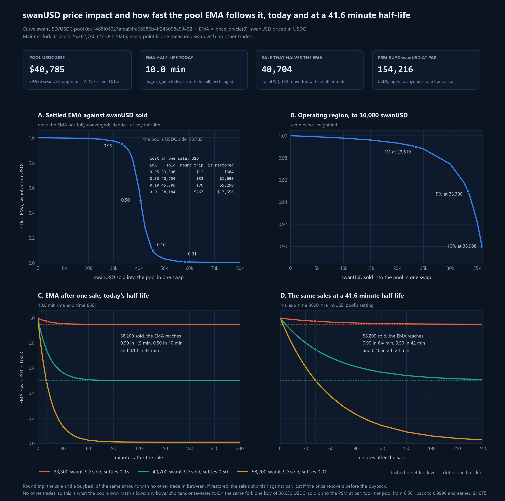
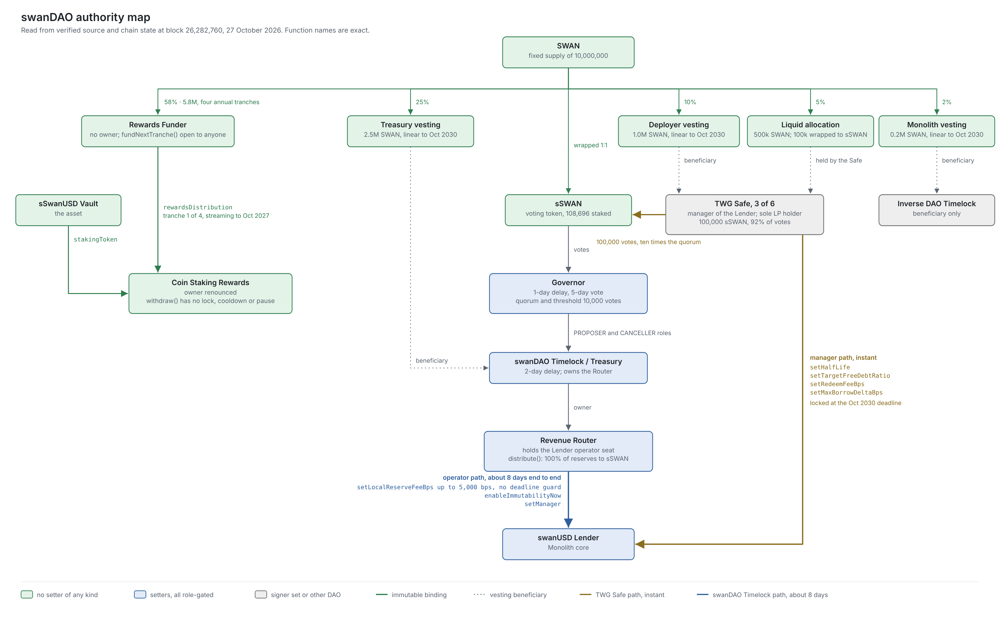

# FiRM Collateral Risk Assessment: sSwanUSD Collateral on FiRM

Inverse Finance Risk Working Group, October 29th 2026

## Contents

- [Briefing](#briefing)
  * [Forward](#forward)
  * [Risk Vectors](#risk-vectors)
  * [Useful Links](#useful-links)
  * [Glossary](#glossary)
- [Protocol Analysis](#protocol-analysis)
  * [Overview](#overview)
  * [Audits and Bug Bounties](#audits-and-bug-bounties)
- [Collateral Risk Analysis](#collateral-risk-analysis)
  * [Liquidity](#liquidity)
  * [Volatility](#volatility)
    + [Reading the Chart](#reading-the-chart)
    + [Limited Effective Arbitrage](#limited-effective-arbitrage)
    + [Redemption Capacity Is Elective](#redemption-capacity-is-elective)
    + [Borrower Concentration](#borrower-concentration)
    + [Risk Summary](#risk-summary)
  * [Contracts](#contracts)
    + [Decentralization](#decentralization)
    + [Access Control + Impactful Variables & Functions](#access-control--impactful-variables--functions)
    + [Upgradable Proxy Implementations](#upgradable-proxy-implementations)
    + [Risk Summary](#risk-summary-1)
- [FiRM Deployments & Design](#firm-deployments--design)
  * [Price Feed](#price-feed)
  * [Escrow](#escrow)
- [Conclusion](#conclusion)
  * [Parameter Recommendations](#parameter-recommendations)

## Briefing

### Forward

This assessment covers a two-market FiRM listing roadmap built around swanUSD, the stablecoin of SWAN DAO, which is the first DAO-governed instance of Monolith's Coin DAO layer. The first market is a guarded listing of sSwanUSD, the deployment's EIP-4626 vault share, deposited governance staked: the borrower deposits the vault share and the [market escrow stakes](https://github.com/InverseFinance/FiRM/pull/145) it into the Coin Staking Rewards contract, so the position carries both the vault's interest accrual and the SWAN emission stream, and FiRM prices the share through the coin's market price multiplied by the vault's share rate. The second market is a follow-up listing of the LP token of the Curve sSwanUSD/DOLA pool, planned once that pool's gauge and incentives are live. The two markets are assessed together because they share one risk surface: both positions resolve to the same underlying exposure, the incentivized pool is the deepest DOLA exit the staked asset will have, and a dislocation in swanUSD stresses both markets at once, so their ceilings draw on one sizing budget rather than two. The pairing supports the first market, since the depth the LP incentives build is exit capacity for the staked asset and gives the feed's arbitrage a second route independent of the PSM reserve, though it adds no depth to the feed pool itself, which reads the separate swanUSD/USDC pool. The roadmap is set out in the [Overview](#overview), and the [Conclusion](#conclusion) carries a parameter table for each market.

The Monolith foundation beneath the deployment, meaning the Factory, the isolated Lender, Coin and Vault triplet it deploys, the peg defense and solvency mechanics those contracts carry, and the audit history behind them, was assessed in full in the RWG's [sinvUSD Collateral Risk Assessment](https://github.com/InverseFinance/Risk-Assessments/blob/main/Monolith_sinvUSD/FiRM_Risk_Assessment_sinvUSD_Monolith.md) of August 2026 and re-measured in the [Mitigation Log and Conclusion](https://github.com/InverseFinance/Risk-Assessments/blob/main/Monolith_sinvUSD/sinvUSD_Reassessment_Mitigation_Log_and_Conclusion.md) of September 30, 2026. This document does not re-derive that material. Wherever the foundation is load-bearing the text links to those documents, and the analysis here confines itself to what swanUSD adds or changes: the Coin DAO governance and rewards layer that sits around the Monolith core, and a collateral base of wstETH rather than sINV.

The RWG's role remains strictly evaluative, to identify risks and recommend safeguard parameters rather than to advocate for either listing. SWAN DAO launched on October 22, 2026, so the deployment is days old at the time of writing, far inside any maturity floor the screening framework recognizes, and every recommendation in the Conclusion is accordingly conditional, phased and sized for guarded markets rather than a listing approval. The compensating fact that shapes this assessment throughout is the collateral itself: wstETH is a blue-chip asset with deep exit liquidity, which removes the single largest problem the sinvUSD assessment had to work around, while the feed, the elective peg defense and the youth of the governance layer remain the live limitations.

### Risk Vectors

**1. The feed reads a single shallow venue.** swanUSD trades in one Curve pool holding about $81,000, which is also the traded leg of the price FiRM would read. A sale of 33,300 swanUSD settles the feed 5% below par, and a sale about the size of the pool's USDC side halves it, at a round-trip cost of tens of dollars to a seller nobody front-runs. The active standing control is the PSM, which lets any caller close a discount wider than the pool fee in a single transaction, and searchers are demonstrably resident in the venue; the supply ceiling bounds what a dislocation could capture. The honest limit is that no discount has printed since launch, so the defense is proven in the premium direction and untested in the one that matters. Read more: [Liquidity](#liquidity), [Reading the Chart](#reading-the-chart), [Price Feed](#price-feed)

**2. The exits that clear a liquidation are a balance and an election, not properties of the market.** Outside the pool, a liquidator's routes are the PSM at par and redemption against free debt, and neither is standing capacity. The PSM reserve is built by demand to hold the coin and drawn down by anyone exiting at par, including borrowers selling what they have just borrowed, so it moves with use in both directions and has done so sharply since launch. Redemption capacity exists only where borrowers have elected free debt, a choice that is theirs, instant and reversible, and that almost none have made. Both are therefore counted at their trailing floor rather than any spot reading. The mechanism that converts a draining reserve into pressure to elect free debt is the rate controller, which has only now entered its target band and begun to apply it, and the airdrop window closing on November 19 is the first scheduled test of both. Read more: [Liquidity](#liquidity), [Limited Effective Arbitrage](#limited-effective-arbitrage), [Redemption Capacity Is Elective](#redemption-capacity-is-elective)

**3. The mitigation this assessment credits is not yet in place.** The case for leaving the feed pool's moving average at its default, and part of the exit-capacity case, rests on the incentivized sSwanUSD/DOLA pool, which does not yet exist along with its feed and escrow. Execution is not gated on Curve governance, since the TWG can incentivize the pool directly while a gauge proposal runs, so depth can accrue as soon as the pool is live. What cannot be compressed is the measurement: incentivized depth is rented, counts at its trailing floor, and contributes to what either market can be sized against only once it has demonstrated that it stays. The assessment is forward-looking here in two bounded ways. The first market's parameters exclude the unbuilt venue entirely, so a slower build costs the expansion case rather than breaching the opening set, and the second market's table is set for the venue as it is intended to launch rather than as it exists, with its ceiling confirmed at deployment against realised depth. Read more: [Liquidity](#liquidity), [Conclusion](#conclusion), [Parameter Recommendations](#parameter-recommendations)

### Useful Links

**RWG Outputs**

- sinvUSD Collateral Risk Assessment, August 2026 - [GitHub](https://github.com/InverseFinance/Risk-Assessments/blob/main/Monolith_sinvUSD/FiRM_Risk_Assessment_sinvUSD_Monolith.md)
- sinvUSD Reassessment: Mitigation Log and Conclusion, September 30, 2026 - [GitHub](https://github.com/InverseFinance/Risk-Assessments/blob/main/Monolith_sinvUSD/sinvUSD_Reassessment_Mitigation_Log_and_Conclusion.md)
- Risk Assessments repository - [GitHub](https://github.com/InverseFinance/Risk-Assessments)
- Trustfall access control reports - [rwg-access-control-reports.vercel.app](https://rwg-access-control-reports.vercel.app/)

**Monolith**

- Official Docs - [docs.monolith.market](https://docs.monolith.market/)
- Audits - [docs.monolith.market/security/audits](https://docs.monolith.market/security/audits)
- Bug Bounty Program - [Sherlock](https://audits.sherlock.xyz/bug-bounties/287)
- SEAL Safe Harbor - [docs.monolith.market/security/safe-harbor](https://docs.monolith.market/security/safe-harbor) / [Proposal #357](https://www.inverse.finance/governance/proposals/mills/357)

### Glossary

| Term | Meaning |
| ---- | ---- |
| Coin DAO layer | Monolith's generalization of the Factory pattern: stablecoin instances deployed with their own governance token and DAO rather than as one-off deployments |
| swanUSD | The stablecoin of SWAN DAO, the first DAO-governed Coin DAO instance, minted against wstETH; the unit the feed's traded leg prices |
| sSwanUSD | The deployment's EIP-4626 vault share, accruing its interest revenue, and the deposit asset of the first proposed market; the escrow stakes the deposited shares into the Coin Staking Rewards contract |
| Coin Staking Rewards | The deployment's StakingRewards contract: sSwanUSD is staked into it and earns SWAN emissions; the staked position is a contract balance, not a transferable token |
| SWAN | SWAN DAO's governance token, emitted to staked sSwanUSD and stakeable in turn for revenue share and voting power |
| sSWAN | Staked SWAN. Carries governance voting power and the deployment's revenue share. Not to be confused with sSwanUSD in any table or feed reference |
| sSwanUSD/DOLA LP | The LP token of the Curve sSwanUSD/DOLA pool, and the asset of the follow-up LP market |
| Free debt | Debt carrying no interest and redeemable against by any swanUSD holder |
| Paid debt | Debt carrying the controller-set variable rate and protected from redemption |
| Redemption | Presenting swanUSD against a free position to take collateral at oracle price less the redemption fee |
| Elective capacity | Redemption capacity that exists only at borrowers' standing choice, so it is not a property of the market |
| Trailing 30-day floor | The lowest redeemable liquidity observed over the preceding 30 days, used in place of a spot reading when sizing ceilings |
| PPO | FiRM's Pessimistic Price Oracle. Caps borrowing power at the collateral's two-day low; effective against borrowing on a recovered price, but does not constrain a liquidation executed during a live dislocation |

## Protocol Analysis

### Overview

SWAN DAO is the first DAO-governed instance of Monolith's Coin DAO layer, live on Ethereum mainnet since October 22, 2026. The deployment has two tiers. The lower tier is a standard Monolith triplet, the immutable lending core that mints swanUSD against wstETH and wraps it in the sSwanUSD vault. Around that core sits the Coin DAO layer, the set of contracts that gives the instance its own token, governance and incentives: the SWAN token, an on-chain Governor and timelock, and a staking rewards system that pays SWAN emissions to staked sSwanUSD. Where this document refers to the Coin DAO layer, it means that upper tier. This section sets the two out in that order, first the Monolith core the instance inherits, then the purpose of the Coin DAO layer built around it, then the verified structure of the position FiRM would hold and the governance that controls it. The analysis of what each piece means for the listing is left to the sections that follow.

The lending core underneath is Monolith's, unchanged: the Factory deploys an independent Lender, Coin and Vault triplet that shares nothing across deployments, carries no upgrade or pause authority, and runs the three peg-defense mechanics and four solvency mechanics the RWG assessed in the [sinvUSD Collateral Risk Assessment](https://github.com/InverseFinance/Risk-Assessments/blob/main/Monolith_sinvUSD/FiRM_Risk_Assessment_sinvUSD_Monolith.md). That document's Overview is the inventory of those mechanics and its carry-forward statement names what any Monolith coin inherits; the [September 30 reassessment](https://github.com/InverseFinance/Risk-Assessments/blob/main/Monolith_sinvUSD/sinvUSD_Reassessment_Mitigation_Log_and_Conclusion.md) then measured how the mechanics behaved in production on invUSD, including the first observed redemption arbitrage against a live dislocation. The reader is directed there for the foundation, which nothing in this deployment changes beyond the collateral asset, wstETH in place of sINV.

The purpose of the Coin DAO layer is to manufacture the liquidity that bound the invUSD listing, where a proven core was held back by a thin feed pool and thin elective redemption capacity with no instrument for deepening either. SWAN is that instrument. Of the fixed 10M supply, 5.8M SWAN funds staking emissions in four declining annual tranches of 32.5%, 27.5%, 22.5% and 17.5% of that reserve; the first tranche of 1.885M SWAN is live on the Coin Staking Rewards contract and runs to October 22, 2027. A further 3.7M sits in four-year vesting wallets for the treasury, deployer and Monolith allocations, and 500k was liquid at launch, of which 100k funds an airdrop claimable by addresses from the Curve, Convex, Yearn, Stake DAO and Inverse communities. What the Coin DAO layer adds beyond the rewards leg is governance. SWAN DAO runs the Coin DAO layer's standard configuration: an on-chain Governor behind a two-day timelock that doubles as the treasury, a proposal threshold and quorum each set at 0.1% of the fixed SWAN supply, a voting delay of about one day and a voting period of about five days, with the vesting wallets described above running to October 2030. Staked SWAN, as sSWAN, carries the voting power and receives the routed share of market revenue, all of it under the default allocation, paid in swanUSD. The deploying operator holds the manager role only until DAO attachment, after which governance assumes control, so parameter decisions that were an operator Safe's instant path on invUSD route here through SWAN voting and the timelock, and the token's distribution and vesting schedule determine who holds that power while the float is thin.

sSwanUSD is the triplet's only vault token, a standard EIP-4626 share priced as swanUSD multiplied by a rate that accrues from the deployment's interest revenue. The SWAN stream that dominates the position's yield is paid separately by the Coin Staking Rewards contract, a Synthetix-style deployment that belongs to the Coin DAO layer rather than the Monolith core, whose staking and reward tokens read on-chain as sSwanUSD and SWAN, and whose position is a contract balance rather than a transferable token, entered through `stake`, exited through `withdraw` and claimed through `getReward`. The market's deposit asset is sSwanUSD itself, deposited governance staked: the escrow stakes the deposited shares into the rewards contract and routes SWAN claims to the borrower, and FiRM prices the share as the coin's market price multiplied by the vault's share rate.

### Audits and Bug Bounties

The Monolith core carries seven audits across 2025 and 2026, from Electisec, ChainSecurity twice, a Sherlock public contest, and three AI-assisted reviews run as one initiative; the full list with report links and remediation status is in the [sinvUSD assessment's Audits and Bug Bounties section](https://github.com/InverseFinance/Risk-Assessments/blob/main/Monolith_sinvUSD/FiRM_Risk_Assessment_sinvUSD_Monolith.md#audits-and-bug-bounties) and is not restated here. Everything swanUSD inherits from the core is covered by that history.

The Coin DAO layer is not. Its contracts, which span the SWAN token, the sSWAN staking vault, the Governor and timelock, the Revenue Router, the Coin Staking Rewards contract and its funder, and the vesting wallets, went to a Sherlock bug bounty structured as a controlled contest, supported by AI-assisted reviews, in place of a traditional audit, and were redeployed on October 8, 2026. A controlled contest places researcher incentives against the code but does not deliver the systematic coverage, remediation dialogue or sign-off of a firm audit, so the layer that holds SWAN DAO's governance, staking and rewards logic stands on a materially lighter review than the core beneath it. The escrow design gives this direct weight: because the sSwanUSD market stakes escrowed collateral into the Coin Staking Rewards contract, FiRM's collateral custody path runs through this layer rather than merely alongside it. The assessment treats this as a standing consideration rather than a gate, consistent with the guarded posture of the Conclusion.

Alongside the Sherlock program, the deployment sits in scope of [Mantis](https://mantis.inverse.finance), Inverse Finance's in-house agentic security platform launched in October 2026, which fields and triages live submissions on a continuous basis rather than on a contest calendar. As of writing, 50 agents are plugged into the platform and submission activity has been high since launch, so the coverage is active rather than nominal. Mantis is part of the same decision the controlled contest reflects, an alternative review posture adopted in place of a traditional firm audit, and the two together are what the Coin DAO layer stands on: continuous agentic detection over the deployed contracts on one side, incentivized researcher review on the other, with neither delivering a firm audit's systematic sign-off.

The [live Sherlock bounty scope](https://audits.sherlock.xyz/bug-bounties/287) lists the swanUSD Lender and the deployment's compounded wstETH price feed as in-scope instances alongside the Factory and InterestModel singletons, and extends to the Coin DAO layer's implementation contracts, the governance token, staked token, Governor, Revenue Router, StakingRewards and its funder, of which the SWAN DAO contracts are minimal-proxy clones. The swanUSD Coin and the sSwanUSD vault are not listed, since only instances named on the program page are eligible, and the SEAL Safe Harbor adopted through [Proposal #357](https://www.inverse.finance/governance/proposals/mills/357) still covers the Factory and InterestModel singletons only. FiRM's deposit path is therefore split across the perimeter: the Lender inside it, the Coin and vault outside, and the rewards contract covered at the implementation level rather than at its deployed address.

## Collateral Risk Analysis

### Liquidity

Liquidity matters twice over in this market, and the two cases are different enough that the assessment keeps them apart. The first is the liquidity behind swanUSD, meaning the wstETH that backs it, which governs whether a liquidation inside the Monolith deployment clears cleanly. wstETH is among the deepest assets in DeFi and already a market on FiRM's own book, so the exit-depth problem that dominated the [sinvUSD Liquidity section](https://github.com/InverseFinance/Risk-Assessments/blob/main/Monolith_sinvUSD/FiRM_Risk_Assessment_sinvUSD_Monolith.md#liquidity) does not arise on this side. At the October 27 reading the deployment held 61.5 wstETH, about $178k at the oracle price, against 98.7k swanUSD of debt, an aggregate LTV of 55.5%.

The second is the liquidity of the coin itself, which governs whether a FiRM liquidation clears, and it is thin. A liquidator who seizes sSwanUSD realizes value by unwrapping to swanUSD and exiting, and at the reading swanUSD traded in one venue, with no CEX listing and no second pool.

| Venue / Pool | TVL | Composition | Notes |
| ---- | ---- | ---- | ---- |
| Curve swanUSD/USDC | $80,721 | 39,936 swanUSD / 40,785 USDC (49/51) | All sticky as protocol-owned liquidity; the TWG Safe, which is also the market's manager, holds every LP token |
| Total (1 pool) | $80,721 | 49/51 | $40,785 is the USDC side available to a seller |

Two further exits sit outside the DEX and end in different assets: the PSM, which buys swanUSD at par for USDS from any caller, and redemption against free debt, which pays wstETH at the oracle price less the 1.75% fee and exists only at borrowers' election ([Redemption Capacity Is Elective](#redemption-capacity-is-elective)).

| Exit | Capacity at the reading | Price | Ends in |
| ---- | ---- | ---- | ---- |
| Curve pool, USDC side | 40,785 swanUSD before price impact | Pool price ([Volatility](#volatility)) | USDC |
| PSM `sell()` | 154,216 swanUSD | Par, no fee | USDS |
| `redeem()` against free debt | 4,561 swanUSD | Oracle less 1.75% | wstETH |

Set against 252.9k swanUSD of supply and 212.9k sSwanUSD outstanding, the hard exit capacity is a small fraction of the asset that could arrive as FiRM collateral, and the PSM is most of it. The PSM figure is a balance, USDS deposited by minters against demand for the coin and drawn down by every par exit, and it moved by a third within hours of the reading ([Limited Effective Arbitrage](#limited-effective-arbitrage)).

**A planned mitigation shapes how these figures should be read.** The venue is five days old, with one pool, one LP position and no second venue to arbitrage against. The same condition on invUSD had no liquidity remedy, since invUSD has no governance token to incentivize a pool with, which is why the mitigations available there were the EMA lengthening and TWG-supplied liquidity. SWAN DAO is different by construction: the Coin DAO layer gives the deployment a governance token, SWAN, and Inverse Finance holds an allocation of it. The TWG intends to use it to incentivize a sSwanUSD/DOLA Curve pool and to follow this market with a non-governance-staked sSwanUSD-DOLA LP token market. Once live, that pool gives the feed venue a second price to be arbitraged against and liquidators a second exit, the cross-venue path the [Mitigation Log](https://github.com/InverseFinance/Risk-Assessments/blob/main/Monolith_sinvUSD/sinvUSD_Reassessment_Mitigation_Log_and_Conclusion.md#1-deepen-the-price-feed-pool) measured defending the invUSD feed pool inside the fee band. This section records the market as it stands; the [Conclusion](#conclusion) weighs the mitigation, which is planned rather than deployed at the time of writing.

Ceiling sizing follows the rule the sinvUSD listing introduced: the trailing 30-day floor of exit capacity, not a spot reading, is the sizing input, with the pool's USDC side, the PSM reserve and the free-debt floor taken together as what a liquidation could actually clear. The deployment launched on October 22, so the window will not hold a full 30 days until late November. To date the floors are launch-day readings, 3,551 swanUSD of free debt and 54,547 USDS in the PSM, and the PSM's post-reading low of 109k is the better guide to where it rests between uses.

### Volatility

swanUSD is a stablecoin, so the volatility that matters is how far and how fast the price FiRM reads can dislocate under liquidity stress, and what stands between a dislocated price and its recovery. The method is the one the [sinvUSD assessment](https://github.com/InverseFinance/Risk-Assessments/blob/main/Monolith_sinvUSD/FiRM_Risk_Assessment_sinvUSD_Monolith.md#volatility) applied to invUSD, re-run against the swanUSD feed venue; the EMA mechanics and the feed's $1.00 clamp are not re-explained here. [Reading the Chart](#reading-the-chart) measures the first question; [Limited Effective Arbitrage](#limited-effective-arbitrage) takes up the second.

*Every point is one swap executed against the Curve swanUSD/USDC pool on a mainnet fork at block 26,282,760 (27 October 2026), after which `price_oracle(0)` was read directly, with no other trade before or after. Panels A and B show the EMA once fully converged, which is the same at any half-life; panels C and D sample it as time advances after one sale, at today's setting and at the setting the invUSD pool now runs.*

#### Reading the Chart

**What the chart prices.** Every curve assumes that nothing answers the sale: the PSM holds no USDS, no borrower carries free debt to redeem against, and no searcher is watching. That is the emergency state for this market, not its operating state, and both halves of it have precedent on the Monolith stack. invUSD's redeemable debt has fallen to a few thousand coins more than once, most recently to about 5,000 invUSD in September ([Mitigation Log](https://github.com/InverseFinance/Risk-Assessments/blob/main/Monolith_sinvUSD/sinvUSD_Reassessment_Mitigation_Log_and_Conclusion.md#5-free-debt-ratio-targets)), and the PSM reserve is a balance that use draws down, taken up under [Limited Effective Arbitrage](#limited-effective-arbitrage). The Inverse Finance team tunes the free-debt band and the redemption fee against observed flow on invUSD and the same levers are in the same hands here, which is why the state is reachable rather than expected. The chart is the price FiRM would read if it were reached and held.

**Pool state.** At the reading the pool held 40,785 USDC against 39,936 swanUSD, with A 250 and a 0.01% fee. The EMA half-life is 10.0 minutes (`ma_exp_time` 866), the factory default, unchanged since the pool was created on October 22.

**Two parameters, one that sets the level and one that sets the clock.** Where the feed settles after a sale, and what the sale costs, is set entirely by the pool's depth; panels A and B are identical at any half-life. When the feed arrives there is set by the half-life, which scales every path in panels C and D by the same factor and nothing else. The two levers sit with different parties. The half-life is a Curve pool parameter held by the [Curve DAO ownership agent](https://etherscan.io/address/0x40907540d8a6c65c637785e8f8b742ae6b0b9968), changed only through a Curve DAO ownership vote, and it was the lever recommended for invUSD because no token existed to incentivize that pool's depth. Depth is a liquidity decision, and for swanUSD it is one the deployment can fund itself, through the SWAN incentives noted under [Liquidity](#liquidity).

**How far one sale moves the feed.** The settled curve is near-linear through the operating region in panel B, then turns over as the pool's USDC side is consumed: a sale about the size of that side halves the feed, and about 58,000 swanUSD, roughly a quarter of supply, takes it to a cent. The round trip is nearly free when nobody else trades, since the buyback recovers the same curve; the only cost that scales with the dislocation is the shortfall a seller is left holding if someone restores the price first.

| Settled EMA | swanUSD sold | Round trip, no other trade | Lost if the price recovers first |
| ---- | ---- | ---- | ---- |
| 0.99 | 23,619 | | |
| 0.95 | 33,300 | $12 | $304 |
| 0.90 | 35,908 | $16 | $489 |
| 0.50 | 40,704 (about the pool's USDC side) | $33 | $1,690 |
| 0.10 | 45,505 | $70 | $5,290 |
| 0.01 | 58,184 | $267 | $17,556 |

*Round trip: the sale and a buyback of the same amount, with no other trade in between. Lost if the price recovers first: the sale's shortfall against par, given up if the price recovers before the buyback.*

**The half-life as a parameter.** At today's setting every sale passes half of its own move in ten minutes. The invUSD pool was lengthened to `ma_exp_time` 3,600 through [Curve vote 1493](https://www.curve.finance/dao/ethereum/proposals/1493-ownership), and panel D shows the same sales at that setting: every time is 4.16 times longer, in both directions, since a genuine repricing and any liquidation gated on the feed are delayed by the same factor, the symmetry the [Mitigation Log](https://github.com/InverseFinance/Risk-Assessments/blob/main/Monolith_sinvUSD/sinvUSD_Reassessment_Mitigation_Log_and_Conclusion.md#2-lengthen-the-moving-average-window-on-the-feed-pool) records as the cost of that change.

| EMA reaches, after a 58,200 swanUSD sale | Today (10.0 minute half-life) | 41.6 minute half-life |
| ---- | ---- | ---- |
| 0.90 | 1.5 min | 6.4 min |
| 0.50 | 10 min | 42 min |
| 0.10 | 35 min | 2 h 24 min |

For each block that a discount stays open, the EMA closes 1.38% of the gap to the pool price today and 0.33% at 3,600.

**Limits.** The fork has one scripted seller and no other participants, so the curves are what the pool's own math allows, not a forecast; any buyer shortens or reverses every path shown, and whether one arrives is the next subsection.

#### Limited Effective Arbitrage

Three paths can retire discounted swanUSD, the same three the [sinvUSD assessment](https://github.com/InverseFinance/Risk-Assessments/blob/main/Monolith_sinvUSD/FiRM_Risk_Assessment_sinvUSD_Monolith.md#limited-effective-arbitrage) traced for invUSD; their capacities are in the [Liquidity](#liquidity) table, and what differs here is the terms on which each pays.

| Path | Pays when | Constraint |
| ---- | ---- | ---- |
| PSM `sell()` | Any discount wider than the pool fee and gas | Capacity is the USDS the PSM holds |
| `redeem()` against free debt | Discount wider than 1.75% plus wstETH exit slippage | Elective; ends in wstETH; retires the free debt it uses |
| Debt repayment at par | Any discount | Solvent, willing borrowers only |

**The PSM removes the dead zone.** On invUSD the redemption fee placed a band of roughly 2% around par inside which nothing arbitraged by construction. swanUSD's PSM is live: `sell()` pays USDS at par with no fee to any caller, so any pool discount wider than the pool's own fee is closable in one transaction, with no borrower, no free debt and no wstETH sale involved. The fork measured this directly: one buy of 36,630 USDC, sold on to the PSM at par, took the pool from 0.501 back to 0.9996 and earned $1,675. When the reserve is spent the dead zone returns, and the only path below 1.75% is redemption against free debt.

**The reserve tracks demand for the coin and is counted at its floor.** The PSM holds the USDS minted against demand for swanUSD beyond what borrowers create: when the pool bids above par, searchers mint at the PSM and sell to it. At the reading that reserve was about 3.8 times the pool's USDC side and 61% of supply, and the demand behind it is largely the airdrop, which pays an equal share of 100,000 SWAN to wallets holding at least 1,000 sSwanUSD for seven consecutive days ending by November 19; 66 stakers sit at or above that threshold and can exit by the same door when the window closes. A durable demand source, which a FiRM market would be, fills the reserve the same way. It drains on borrower activity alone: in the nine hours after the reading one borrower drew 50,000 swanUSD against wstETH and sold all of it to the PSM, and the reserve fell 29%. The reserve is therefore sized at its trailing floor under the rule set out in [Liquidity](#liquidity); what it adds above that is margin. The rate controller also reads it as free debt, which the next subsection takes up.

**Whether the arbitrage has fired.** No discount has printed in the venue's five days; the lowest EMA reading since launch is 0.99978 and the highest 1.00042. The premium side of the same trade has been exercised continuously: arbitrage contracts minted about 87,700 swanUSD at the PSM and sold it into the pool, half of all PSM minting to date, across a venue that has seen 94 swaps by 18 traders. Searchers are routing between the PSM and the pool today, and the discount direction uses the same two contracts in the opposite order. The class precedent for a corrective response through a feed pool is the [September 10 episode](https://github.com/InverseFinance/Risk-Assessments/blob/main/Monolith_sinvUSD/sinvUSD_Reassessment_Mitigation_Log_and_Conclusion.md#4-establish-the-redemption-arbitrage-as-observed-rather-than-assumed) on invUSD, answered in 52 minutes; swanUSD's path is shorter in mechanism and already has participants, but no dislocation has yet tested it.

#### Redemption Capacity Is Elective

Redemption is what ties swanUSD to its collateral, and it applies only to borrowers who have opted into free debt through `setRedemptionStatus`, a choice that is theirs, instant and reversible. The mechanism, the rate controller that steers it and the reasons a borrower under redemption pressure switches to paid debt are set out in the [sinvUSD assessment](https://github.com/InverseFinance/Risk-Assessments/blob/main/Monolith_sinvUSD/FiRM_Risk_Assessment_sinvUSD_Monolith.md#redemption-capacity-is-elective) and are not repeated. No band setting binds capacity: the band moves the rate, and borrowers decide what the rate is worth to them.

| Parameter | swanUSD |
| ---- | ---- |
| Redemption fee | 1.75% |
| Target free-debt band | 15% to 35% |
| Controller half-life | 7 days at the reading; 14 days from October 28 |
| Free debt at the reading | 4,561 swanUSD |
| Paid debt at the reading | 94,093 swanUSD |
| Free-debt ratio, borrowers only | 4.6% |
| Free-debt ratio as the controller reads it | 62.8% |

**The controller is reading the PSM, not the borrowers.** `getFreeDebtRatio()` counts the PSM reserve as free debt, which puts the controller's reading above the band while borrowers alone are at 4.6%. It has therefore decayed the rate at every point since launch, from 1.94% to 1.26% at the reading toward the 0.5% floor, and pushed no one toward free debt. Without the PSM the reading would sit below the band and the rate would be rising. The manager Safe doubled the half-life to 14 days on October 28, the deployment's first parameter change, so the controller now moves at half the speed in both directions. If the reserve drains it re-enters the band from above and begins raising the rate on that fourteen-day clock, and whether borrowers then elect free debt is the open question.

**Observed election.** At a 1.26% rate the cost of staying unredeemable is small, and 27 of 31 borrowers have chosen it. Four wallets elected free debt in the first week, none has reversed, and no redemption, liquidation or write-off has executed. invUSD's first corrective redemption came after five months and a dislocation; swanUSD has had neither.

**The trailing floor.** The 30-day floor of free debt since launch is 3,551 swanUSD, and under the [Liquidity](#liquidity) sizing rule that figure, not the spot reading, is what a redemption defense can be relied on for.

#### Borrower Concentration

The book presented as 31 borrowers at the reading, carrying 98.7k swanUSD of debt, with the largest wallet holding 40% of it. Funding traces, by the method the [sinvUSD assessment](https://github.com/InverseFinance/Risk-Assessments/blob/main/Monolith_sinvUSD/FiRM_Risk_Assessment_sinvUSD_Monolith.md#borrower-concentration) applied, reduce the wallet count to 24 economic clusters, and the book moved sharply after the reading: one new borrower drew 50,000 swanUSD against 31 wstETH, so that by the end of October 27 the book stood at 150.8k with one wallet holding about a third of it.

| | Top 1 | Top 3 | Top 5 |
| ---- | ---- | ---- | ---- |
| Share of debt by wallet | 39.9% | 58.7% | 66.8% |
| Share of debt by cluster | 39.9% | 65.0% | 74.6% |

The tail is visible without a trace: most positions were opened at 1,000 to 1,100 swanUSD and staked in full within minutes, the size the airdrop threshold requires, and 29 of the 31 borrowers stake. The borrower count therefore overstates the parties with an economic stake in the book, and the free-debt election sits with four wallets carrying 4.6% of it.

Concentration lands on FiRM through the write-off path, which socializes a default by the largest cluster onto the few remaining holders including the vault FiRM would hold, and through the election, since redeemable capacity is a handful of standing choices revocable in one transaction. The collateral side is less exposed than on invUSD, because a large liquidation sells wstETH rather than sINV.

#### Risk Summary

1. **Settled discounts are reachable, and the chart prices the emergency state.** The feed reads one Curve pool of about $81,000, so a sale about the size of its USDC side halves the feed and a quarter of supply takes it to a cent, with the half-life setting only how fast that registers. The chart assumes nothing answers the sale; at the reading the PSM would answer it at par up to about 3.8 times the pool's USDC side, which is the condition invUSD lacked. FiRM's pessimistic oracle caps borrowing power at the two-day low but cannot act while the price sits at that low, so a liquidation inside a live dislocation is priced at the raw feed. The planned sSwanUSD/DOLA pool addresses depth directly and is not in any figure.
2. **The par exit is a reserve that tracks demand for the coin, and it is counted at its floor.** The PSM holds the USDS minted against demand for swanUSD beyond what borrowers create; today that demand is largely the airdrop, which ends November 19, and a FiRM market would be a more durable source. The reserve drains on any par exit, including borrowers selling what they have just borrowed, and fell 29% in the nine hours after the reading on one such exit. While it stands it removes the redemption dead zone; when it drains, the dead zone returns and the only path below it is redemption against 4.6% of the book. Until the deployment has a history, the reserve is sized at its trailing floor and what it adds above that is margin.
3. **Redemption capacity is elective, and the controller is not building it.** The controller counts the PSM as free debt, has sat above its band since launch, and is decaying the rate, so no borrower is being pushed toward free debt while the reserve holds. Capacity is four wallets' standing choice, the trailing floor since launch is 3,551 swanUSD, and no redemption has been exercised on this deployment.

### Contracts

The contracts this assessment examines directly are below. The Lender, Coin and Vault were deployed by the current Monolith Factory and read its InterestModel, both V2 deployments of September 2026; those shared singletons and the Coin DAO implementations each SWAN DAO clone is minted from are listed on [Monolith's contract addresses page](https://docs.monolith.market/developers/contract-addresses), and the full per-instance list for this deployment, market and DAO, sits under Technical Details in the [Monolith app](https://app.monolith.market/1/coin/2).

| Contract | Address |
| ---- | ---- |
| sSwanUSD FiRM Market | [0x529203f9F07c66d2D96812E3D942387312Fab0Ee](https://etherscan.io/address/0x529203f9f07c66d2d96812e3d942387312fab0ee#code) |
| sSwanUSD Price Feed | [0x9037D5FB69dF49281832fFA87a38E94fd695f423](https://etherscan.io/address/0x9037d5fb69df49281832ffa87a38e94fd695f423#readContract) |
| swanUSD Lender | [0x4ed5c72816aBc1b67ac31DdAbE31cff4a8c56a15](https://etherscan.io/address/0x4ed5c72816aBc1b67ac31DdAbE31cff4a8c56a15) |
| swanUSD Coin | [0x9BF2B2F57A2968A0E81546Ed50cBbbb7C9d6e05E](https://etherscan.io/address/0x9BF2B2F57A2968A0E81546Ed50cBbbb7C9d6e05E) |
| sSwanUSD Vault | [0xfa80c7349cC2357C42A64C2954B24B1a61C29435](https://etherscan.io/address/0xfa80c7349cC2357C42A64C2954B24B1a61C29435) |
| Coin Staking Rewards | [0x3C3Ae3F3a645efe6299f0EDfFb3162E630Db956a](https://etherscan.io/address/0x3C3Ae3F3a645efe6299f0EDfFb3162E630Db956a) |
| Curve swanUSD/USDC (feed source) | [0xc1488f04027afEa94FA68586B4Ff245098a59432](https://etherscan.io/address/0xc1488f04027afEa94FA68586B4Ff245098a59432) |
| Manager (TWG Safe, 3 of 6) | [0x9D5Df30F475CEA915b1ed4C0CCa59255C897b61B](https://etherscan.io/address/0x9D5Df30F475CEA915b1ed4C0CCa59255C897b61B) |
| Operator (Revenue Router) | [0xf69f74148687ca4860544f865581F05cA3f9098c](https://etherscan.io/address/0xf69f74148687ca4860544f865581F05cA3f9098c) |

#### Decentralization

The Monolith core's authority picture is unchanged from invUSD and is not re-derived: the manager Safe's instant path, the operator path, the shared InterestModel and the immutability deadline are set out in the [sinvUSD Contracts section](https://github.com/InverseFinance/Risk-Assessments/blob/main/Monolith_sinvUSD/FiRM_Risk_Assessment_sinvUSD_Monolith.md#contracts) and the [Trustfall report](https://rwg-access-control-reports.vercel.app/reports/collateral/Monolith_invUSD.html). This section covers what the Coin DAO layer adds, read from verified source and chain state at the October 27 reading.

*SWAN DAO authority map at the reading. Green marks contracts with no setter of any kind, blue marks contracts whose setters are all role-gated, grey marks signer sets and other DAOs. The gold path is the TWG Safe's instant route to the Lender and its votes; the blue path is the SWAN DAO Timelock's route through the Revenue Router, about eight days end to end.*

#### Access Control + Impactful Variables & Functions

**The operator seat is a SWAN DAO contract.** The Lender's operator is the Revenue Router, owned by the SWAN DAO Timelock, and the seat cannot move: the Router has no path to `setPendingOperator`. Through the Router the Timelock reaches three Lender functions, `setLocalReserveFeeBps`, `enableImmutabilityNow` and `setManager`, each behind a one-day voting delay, a five-day vote and a two-day timelock, roughly eight days end to end. The local reserve fee stands at 5,000 bps, the V2 cap, and its setter carries no deadline guard, so the Timelock keeps that lever after the October 2030 immutability deadline when the rest lock. The manager Safe holds the other four levers on the instant path, as on invUSD, and used one of them for the first time on October 28 when it raised the controller half-life.

| Lever | Authority and delay | What it moves |
| ---- | ---- | ---- |
| `setHalfLife`, `setTargetFreeDebtRatio`, `setRedeemFeeBps`, `setMaxBorrowDeltaBps` | TWG Safe, 3 of 6, instant; locked at the 2030 deadline | Rate controller speed and band, redemption floor, borrow throttle |
| `setLocalReserveFeeBps` (to 5,000 bps) | SWAN DAO Timelock via the Router, about 8 days; no deadline | Share of interest diverted from sSwanUSD holders to sSWAN stakers |
| `enableImmutabilityNow`, `setManager` | SWAN DAO Timelock via the Router, about 8 days | Ends all tuning early; replaces the Safe |
| `distribute()` | Anyone | Pulls accrued reserves and credits 100% to sSWAN |

**SWAN DAO governance is concentrated at launch.** Five days in, the Safe holds 100,000 of 108,696 sSWAN, 92% of votes and ten times both the 10,000-vote quorum and proposal threshold; three other delegates hold the rest. It is also the Lender's manager, the sole LP holder in the feed pool and the deployer vesting beneficiary, so both paths to the Lender resolve to the same six signers today, one instant and one eight days long. The Mantis bounty lists early deployer control of a Coin DAO through its liquid allocation as a known, accepted issue. No proposal has been created and the Timelock has scheduled nothing. The Safe's share dilutes on the emission schedule: tranche 1 pays stakers the equivalent of the Safe's whole voting position about every three weeks, and 58% of supply reaches stakers over four years.

**The custody path has no owner.** Coin Staking Rewards, where a FiRM escrow would hold sSwanUSD, had its owner renounced at deployment; `withdraw()` carries no lock, cooldown or pause, and nothing can block an escrow from withdrawing. The Rewards Funder has no owner or admin and its `fundNextTranche()` is permissionless.

**SWAN distribution.** Supply is fixed at 10,000,000, allocated once by the CoinDAOFactory:

| Bucket | Share | Holder | Terms |
| ---- | ---- | ---- | ---- |
| Staking rewards | 58% | Rewards Funder | Four annual tranches; tranche 1 (1.89M) streaming to October 2027 |
| Treasury vesting | 25% | SWAN DAO Timelock | Four years linear to October 2030, no cliff |
| Deployer vesting | 10% | TWG Safe | Same |
| Liquid allocation | 5% | TWG Safe | 100,000 wrapped to sSWAN, 52,678 to a Curve SWAN/WETH pool |
| Monolith vesting | 2% | Inverse DAO Timelock | Same as treasury |

The 100,000 SWAN airdrop has no allocation of its own and no claim contract at the reading, so it can only be paid from the Safe's liquid balance.

#### Upgradable Proxy Implementations

Nothing SWAN DAO deploys is upgradeable. Every Coin DAO contract is an EIP-1167 clone of a verified implementation that reads zero at every EIP-1967 slot, so each clone's logic is fixed in its bytecode; the Lender, Coin and Vault are Factory children and carry the same guarantee the sinvUSD assessment established for the core. The two upgradeable contracts in reach are Sky's, USDS and sUSDS behind the PSM.

#### Risk Summary

1. **SWAN DAO's control is concentrated at launch.** Both paths to the Lender resolve to the TWG Safe today, a snapshot five days in that the emission schedule dilutes by construction as stakers accrue, wrap and delegate SWAN. For a market Inverse operates this is an operational fact; the review item for future Coin DAO listings is the same structure under a third-party deployer.
2. **Two operator-path levers sit with SWAN DAO governance, and one survives immutability.** The Timelock can divert up to half of all interest from sSwanUSD holders to sSWAN stakers, and can do so after the 2030 deadline, which is the one lever that directly changes what a FiRM lender holds. It is eight days slow and visible on chain, so it is a monitoring item rather than a structural risk while the vote sits with Inverse's own working group.

## FiRM Deployments & Design

### Price Feed

This assessment covers two markets, and each reads its own feed. Both price swanUSD somewhere in their chain, and swanUSD's own collateral is priced separately by Monolith and never reaches FiRM: the swanUSD Lender reads [WstETHPriceFeedCompounded](https://etherscan.io/address/0x6148B9e0246380A70f1404C78B66661F39f76c90) for wstETH, on an effective 24-hour heartbeat against a 30-hour `stalenessThreshold()`, past which the Lender enters `reduceOnly` and decays the price to zero over a further 24 hours. That governs the loan book's solvency rather than FiRM's mark, so it belongs on the monitoring list rather than in either chain below.

#### sSwanUSD (governance staked)

FiRM would read a four-component chain in the shape the RWG has reviewed on its other Monolith and vault-share markets: a Curve EMA for the stablecoin leg, a Chainlink leg to dollars, a clamp at par, and the vault's own share price.

| # | Component | Role | Mutable surface |
| ---- | ---- | ---- | ---- |
| 1 | [Curve swanUSD/USDC](https://etherscan.io/address/0xc1488f04027afEa94FA68586B4Ff245098a59432) `price_oracle(0)` | swanUSD in USDC, 10-minute EMA | `ma_exp_time`, held by the Curve DAO ownership agent |
| 2 | [Chainlink USDC/USD](https://etherscan.io/address/0x8fFfFfd4AfB6115b954Bd326cbe7B4BA576818f6) | USDC to dollars | External push feed; 0.25% deviation, 82,800s heartbeat |
| 3 | ClampedPriceFeed | Caps the stablecoin leg at $1.00 | None, constructor-fixed |
| 4 | [sSwanUSD Vault](https://etherscan.io/address/0xfa80c7349cC2357C42A64C2954B24B1a61C29435) `previewRedeem` | Accruing share rate | External, read live |
| 5 | [ERC4626Feed](https://etherscan.io/address/0x9037d5fb69df49281832ffa87a38e94fd695f423#readContract) | Composes the chain | None, constructor-fixed |

**The clamp.** It caps the swanUSD leg at $1.00 with no floor and sits before the share multiply, the arrangement the [sinvUSD Price Feed section](https://github.com/InverseFinance/Risk-Assessments/blob/main/Monolith_sinvUSD/FiRM_Risk_Assessment_sinvUSD_Monolith.md#price-feed) argues and this document does not re-derive: $1.00 is a stablecoin's correct ceiling, while sSwanUSD is a claim on a growing pile of swanUSD and legitimately exceeds it, so the accrual leg is left unbounded.

**Staleness.** Only the Chainlink leg carries a timestamp. The Curve EMA and the share price are read live from chain state on every call and cannot go stale, so that leg's cadence is the sole staleness control. USDC/USD writes a new answer on a 0.25% deviation or after 82,800 seconds, whichever comes first, so the market's staleness threshold has to clear 23 hours to avoid marking the feed stale in ordinary operation. That is a materially longer window than the sinvUSD market carries, whose own source leg runs on an hourly heartbeat, and it is the one value in this chain the Conclusion sets rather than reads.

**The feed prices the asset to zero, so no wind-down path is required.** A feed whose source cannot report below some floor cannot recognize a collapse in that source, and a market reading one would need a mechanism to retire it by hand. This chain carries no such floor. The swanUSD leg reads its pool directly, with the pool's coins ordered so that `price_oracle(0)` returns swanUSD in USDC without inversion, so the StableSwap-NG EMA's 2.0 cap bounds the leg above rather than placing a floor beneath it, and the clamp above it is a ceiling with no floor of its own. The Volatility study measured the result rather than assuming it: on a mainnet fork the settled feed falls through 0.10 and reaches a cent on a large enough sale. That is the behaviour a collateral feed must have, and it is why this market needs no wind-down feed. What the feed cannot do is dampen a liquidation executing inside a live dislocation, which is FiRM's pessimistic price oracle's job and is argued under [Volatility](#volatility).

#### sSwanUSD-DOLA LPT

The feed for the non governance staked sSwanUSD-DOLA LP token market is not yet deployed. This subsection will carry its contract chain, parameters and staleness control once the contracts are live.

### Escrow

#### sSwanUSD (governance staked)

The proposed market lists governance staked sSwanUSD: the vault share staked into [Coin Staking Rewards](https://etherscan.io/address/0x3C3Ae3F3a645efe6299f0EDfFb3162E630Db956a), where it earns SWAN while backing a loan. The share itself does not carry that stream, so a plain token escrow would hold the collateral and forfeit the emissions. FiRM would use `StakingRewardsEscrow` instead, with a copy created for each borrower by the Market on first deposit. A deposit helper sits in front of the market to collapse the approve, wrap and deposit steps; it is an onboarding convenience and carries no part of the collateral accounting.

**What the escrow holds, and who can move it.** The borrower's collateral is the sum of idle and staked shares, so staking does not change the accounting. Only the Market can move it out, and on a withdrawal or a liquidation it spends idle shares first and unstakes exactly the remainder, so the unstake is a sized `withdraw` rather than an `exit` and collateral recovery is never coupled to a reward transfer succeeding. The escrow has no admin, no pause and no upgrade path, and beneath it the rewards contract's `owner()` was renounced at deployment, leaving `setRewardsDistribution` permanently unreachable and `withdraw(uint256)` free of any lock, cooldown or pause. A liquidator can always reach the collateral, which is the property a staking custody path most needs. What the path does carry is the Coin DAO layer's lighter review, since the contract holding FiRM's collateral belongs to that layer rather than sitting alongside it, argued in [Audits and Bug Bounties](#audits-and-bug-bounties).

**SWAN stays with the borrower, including through a liquidation.** The borrower claims at any time or allows another address to claim for them, and an allowed claimer can move rewards only, never collateral. A liquidation seizes sSwanUSD alone, so SWAN earned before it remains the borrower's. A liquidator's entire return is therefore the incentive on the shares seized, with no accrued emissions attached, so that incentive has to stand against the exit cost measured under [Liquidity](#liquidity) rather than against the headline yield.

#### sSwanUSD-DOLA LPT

The escrow for the non governance staked sSwanUSD-DOLA LP token market is not yet deployed. This subsection will carry its details once the contract is live.

## Conclusion

The risk profile supports both markets in a guarded initial phase. The case rests on the deployment's structure and the trajectory of its indicators rather than on five days of history alone, while the parameters themselves stay within what the deployment has measured, since a market this young should not be committed to conditions it has yet to reach.

**Two backing legs.** swanUSD is backed by wstETH where it is borrowed and by USDS in the PSM where it is minted, roughly 39% and 61% of supply at the pinned reading and shifting toward the first as the week's borrowing has drawn the reserve down. wstETH is among the deepest collateral assets on FiRM's own book and removes the exit-depth constraint that dominated the sinvUSD assessment. The USDS held against the minted share is a par exit open to any caller without fee, which is the most consequential functional difference between this coin and invUSD and is taken up below.

**The risk flywheel.** Demand for the collateral builds the defense behind it, provided the demand is to hold the coin rather than to borrow against it. A FiRM market creates the first kind, because collateral must be held, and each route to acquiring it deepens an exit a liquidator would use. Minting at the PSM grows the par exit directly. Buying on the pool lifts it above par, the condition under which searchers mint at the PSM and sell into the venue, a leg that already accounts for half of all PSM minting to date. Borrowing against wstETH grows the book from which free debt is elected. Leverage demand runs the same mechanism in reverse, since a borrower who draws swanUSD and sells it at par converts the reserve into a wstETH-backed position rather than into exit capacity.

**This week has run in the second direction.** Supply rose from 65,000 to 260,000 swanUSD across the first five days and the loan book from 10,500 to 150,800; in the day since the pinned reading the book reached 269,000 while the PSM reserve fell from 154,000 to 51,000. The system has begun to answer it. As the reserve drew down, the rate controller's reading fell from 62.8% to 17.4% and entered its target band, so the borrow rate has stopped decaying for the first time since launch and begins to rise if the reserve falls further. That is precisely the lever intended to push borrowers toward redeemable debt, about to be exercised for the first time in the deployment's life.

**The feed's moving average.** The lengthening recommended for invUSD addressed a condition this deployment does not share: that market had no arbitrage path paying inside its fee band, so a dislocation could persist unanswered and the only available defense was a feed slow to register it. Here any discount wider than the pool fee is closable in a single transaction against the PSM, and searchers are already resident in the venue. The second market reinforces this rather than duplicating it, since an incentivized sSwanUSD/DOLA pool gives the same arbitrage a route independent of the PSM reserve, and the vault share price links the two venues deterministically on chain. The RWG does not recommend a change to the feed pool's `ma_exp_time` for this listing. The question would reopen only if the PSM were drained while the second venue remained unlaunched.

**The limits of the record.** The feed reads a single pool of approximately $81,000, where a sale on the order of its USDC side halves the reported price. Redeemable debt has not moved since the deployment's second day, so its share of the book has fallen from 33.7% at launch to 1.7% as the book grew around it, held throughout by four wallets, with no redemption executed. The deployment is five days old, no liquidation or write-off has occurred, and the demand behind the PSM reserve is substantially attributable to the airdrop, whose window closes on November 19, placing the market's first weeks alongside the largest anticipated shift in its own demand. None of this argues against the structure. It establishes that the structure has not yet been exercised, and the opening parameters are therefore a floor rather than a forecast.

**The pattern has run in production.** sinvUSD was the first Monolith coin listed on FiRM, under the guarded ceiling the September reassessment recommended, and the market has run since September 10, 2026 without liquidation, bad debt or feed disruption, carrying 22,411 DOLA of borrows today against its 200,000 ceiling. That record covers a different coin, a small book and calm conditions, and the market has met no dislocation of its own. What it establishes is that the architecture this listing reuses, a Monolith vault share held as FiRM collateral, a Curve-and-Chainlink feed chain reading a thin venue, and a guarded ceiling expanded against named markers, has carried real exposure rather than only modelled it. Genuinely new here are the staking escrow and the Coin DAO layer beneath it, both assessed above.

**Sizing and expansion.** The measure the sinvUSD listing established, a trailing thirty-day floor rather than a spot reading, was adopted for redemption liquidity, and it applies here to redemption and to the PSM reserve alike, since both are capacity that can be revoked without notice. The reserve's move this week is the argument for it: a parameter set against any single reading would have been stale within a day.

DEX depth is a different kind of capacity and takes a different treatment. The feed pool is protocol-owned and has not moved, so it counts at its current reading. Incentivized third-party depth, which is what the sSwanUSD/DOLA pool will attract, counts at its own trailing floor, since rented liquidity leaves when the incentive stops and should demonstrate that it stays before it is sized against. The usable figure is therefore the sum of owned depth at reading, rented depth at floor, and the PSM and free-debt floors, and unlike the sinvUSD measure it grows as the liquidity programme executes. Increases are judged against that figure and the markers behind it: the trailing floor of free debt and its concentration, the depth and ownership of each venue, the PSM reserve's floor through and beyond the airdrop window, and the response time on the first genuine dislocation. Each is a line on the RWG's monitoring dashboard.

### Parameter Recommendations

#### #1 FiRM Market: sSwanUSD (governance staked)

| Parameter | Recommendation |
| ---- | ---- |
| Collateral Factor | 85% |
| Liquidation Factor | 100% |
| Liquidation Incentive | 5% |
| Supply Ceiling | 500,000 DOLA |
| Daily Borrow Limit | 100,000 DOLA |
| Minimum Debt | 3,000 DOLA |
| Staleness Threshold | 82,900 seconds |

#### #2 FiRM Market: sSwanUSD-DOLA LPT

The sSwanUSD-DOLA LP token market carries its own table. Its pool, feed and escrow are not yet deployed, so those figures are what the RWG recommends for that market once they are live. The depth it builds also serves the first market and the venue gives the feed a new arbitrage route, so the two are reviewed together and the first reassessment of the governance staked parameters should follow this listing.

| Parameter | Recommendation |
| ---- | ---- |
| Collateral Factor | 85% |
| Liquidation Factor | 100% |
| Liquidation Incentive | 5% |
| Supply Ceiling | 1,000,000 DOLA |
| Daily Borrow Limit | 200,000 DOLA |
| Minimum Debt | 3,000 DOLA |
| Staleness Threshold | Set at deployment |
