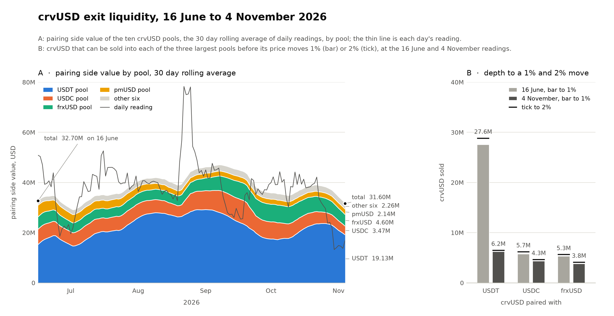
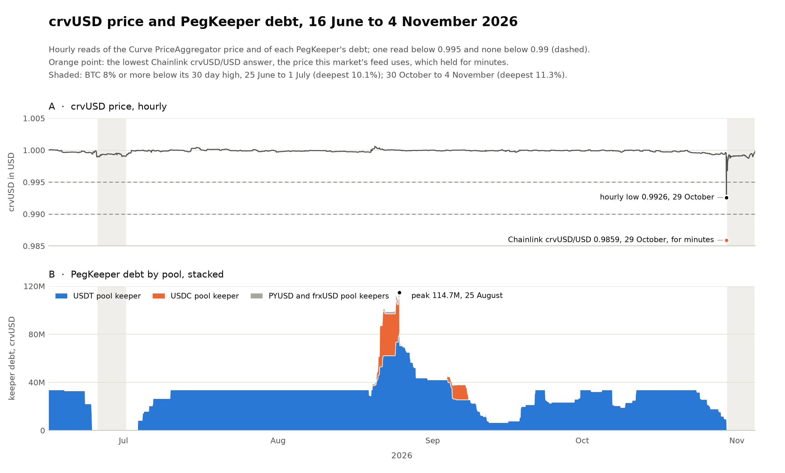
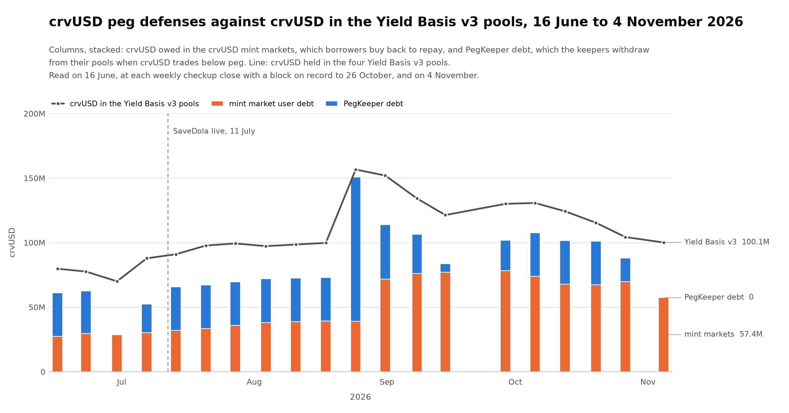
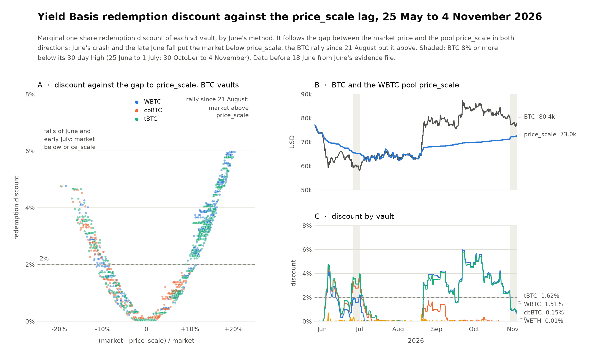
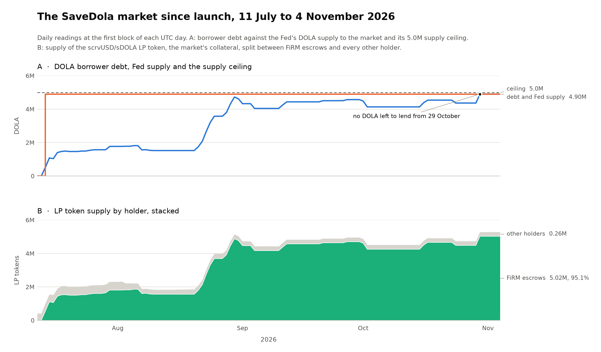

# scrvUSD-sDOLA FiRM Market: Parameter Refresh Assessment

*Due diligence sheet with a provisional conclusion. Inverse Finance Risk Working Group, November 2026. An update to the [June 2026 crvUSD Risk Refresh Assessment](https://github.com/InverseFinance/Risk-Assessments/tree/main/crvUSD-Risk-Refresh-Assessment) covering the months since.*

**Scope.** FiRM's scrvUSD-sDOLA market ([SaveDola](https://etherscan.io/address/0xc45e9c231ab5d9bd3f1131e7901b100d8d236c4d)) and what it depends on: the scrvUSD/sDOLA collateral pool, crvUSD, Yield Basis and the Stake DAO escrow. The sheet compares readings on 16 June and 4 November 2026; the market's own record starts at its launch on 11 July. Figures are read on chain at those dates, except June values quoted from the June assessment. Events come from the RWG's weekly checkups; Yield Basis votes and plans come from its governance page and the team's forum posts. Yield Basis figures cover only its current (v3) markets, into which its older markets are being moved.

## Contents

- [Foreword](#foreword)
- [1. Stability at a Glance](#1-stability-at-a-glance)
- [2. Market Performance Since Launch](#2-market-performance-since-launch)
- [3. Collateral Pool: scrvUSD/sDOLA](#3-collateral-pool-scrvusdsdola)
- [4. crvUSD Peg, Backstops and Exit Liquidity](#4-crvusd-peg-backstops-and-exit-liquidity)
- [5. Yield Basis Exposure](#5-yield-basis-exposure)
- [6. Stake DAO Escrow](#6-stake-dao-escrow)
- [7. Loss Buffer, Adjacent Markets and Governance](#7-loss-buffer-adjacent-markets-and-governance)
- [8. Conclusion](#8-conclusion)
- [Figures](#figures)

## Foreword

This parameter refresh assessment has been prepared by the Inverse Finance RWG as an update to the June 2026 crvUSD Risk Refresh Assessment, covering the months since FiRM's scrvUSD-sDOLA market went live on 11 July 2026. It was prompted by borrower demand that has held the market near its supply ceiling since late August, and it reassesses whether the parameters set at launch remain appropriate given how the market, crvUSD, Yield Basis, and the Stake DAO escrow have behaved across the period, including the 29 October crvUSD dip that gave the market its first live feed test.

While the RWG has conducted a full review and provides parameter recommendations, this document should not be read as the RWG advocating for or against raising the market's exposure. Our role is strictly evaluative, focused on identifying what has and has not held since June and the safeguards appropriate to any change, rather than on promoting a growth initiative. The recommendations that follow are sized to the evidence, and the watch-items are set out so that governance can weigh the raise against the risks that remain in active change, chiefly the Yield Basis Pyth and A-parameter upgrades still rolling out.

## 1. Stability at a Glance

Has anything the June assessment relied on failed since? Each row names one dependency, its state since June, and where the record is kept.

| Area | Since June | Evidence |
| :---- | :---- | :---- |
| The market | no failure | live 116 days; one liquidation (17 July, a 3,005 DOLA position repaid in full); no bad debt; no liquidation in the 29 October crvUSD dip |
| crvUSD peg | held, one brief dip | Curve's aggregate price: lowest hour 0.9926 (29 October), below 0.995 for about 30 minutes that evening and never below 0.99; no other hour below 0.995 |
| crvUSD price feed | updated throughout | Chainlink crvUSD/USD updated about daily; on 29 October it followed a brief crvUSD dip to 0.9859, held for about 6 minutes, and this market's collateral price fell 1.4% with it, recovering within minutes |
| PegKeepers | used, twice to zero | Late June BTC fall: drawn to zero, rebuilt to 33.75M by 10 July From 23 October: drawn down, reaching zero on 30 October; not rebuilt by 4 November |
| Borrow backstop | grew | 30 day average: 47.7M in June, 67.8M on 4 November Spot on 4 November: 57.4M, after falling in the late October dip |
| crvUSD and scrvUSD contracts | no failure | RWG weekly checkups (Trustfall scans) to 3 November; changes only by Curve votes ([section 7](#7-loss-buffer-adjacent-markets-and-governance)) |
| Yield Basis v3 | no incident | no market added or removed; its WETH pool's new fee and price policy, run on Pyth price reports, live since 29 October, its emergency stop never used; a deposit route that leaked value from the pools is being closed ([section 5](#5-yield-basis-exposure)) |
| A BTC fall deeper than June's 23% | not seen | the largest, about 11% below its 30 day high, reached its low on 3 November |
| Stake DAO escrow | exit works | FiRM's guardian withdrawal passed a fork test on 21 October; two custody alerts (September and October), both benign; none since |
| crvUSD exit liquidity | fell late in the window | 30 day average: 32.7M in June, 31.6M on 4 November Last week of October: the ten pools' pairing side fell from about 32M to about 14M |

## 2. Market Performance Since Launch

| Indicator | At launch, 11 July | 4 November |
| :---- | :---- | :---- |
| Supply | 5.0M ceiling | 4.9M supplied by the Fed since 13 July (98% of the ceiling) |
| Borrower debt | 0 | 4.90M, all of the Fed's supply since 29 October; 1.47M on 20 July |
| Borrowers | 0 | 7; the largest holds 68% of debt |
| Position LTVs | n/a | 80.0% to 84.5%, against an 87% collateral factor |
| Daily borrow limit | 500,000 | filled to 99.96% on 24 August and again on 29 October |
| Parameters | CF 87%, liquidation incentive 5%, liquidation factor 100%, minimum debt 3,000 | unchanged; feed staleness threshold 0 ([section 8](#8-conclusion)) |
| Price feed | June's pessimistic LP design | as designed: the lower of crvUSD (Chainlink) and DOLA at $1, times the pool's virtual price |
| Share of FiRM | n/a | 7.3% of FiRM debt; 4.3% of DOLA supply |

## 3. Collateral Pool: scrvUSD/sDOLA

| Indicator | 16 June | 4 November |
| :---- | :---- | :---- |
| Pool TVL | 0.42M | 6.17M |
| Mix by value, scrvUSD and sDOLA | 19% and 81% | 24% and 76% |
| LP held in FiRM escrows | n/a | 95.1% of supply |
| Sale that moves the pool price 1%, scrvUSD sold for sDOLA (in scrvUSD) | 0.26M | 3.57M |
| Sale that moves the pool price 1%, sDOLA sold for scrvUSD (in sDOLA) | 0.03M | 0.58M |
| Pool price averaging window | 866 s | 3,600 s (changed 2 September) |

## 4. crvUSD Peg, Backstops and Exit Liquidity

| Indicator | 16 June | 4 November |
| :---- | :---- | :---- |
| Lowest hourly price | 0.9976 (5 June, before the window) | 0.9926 (29 October, below 0.995 for about 30 minutes) |
| Lowest Chainlink crvUSD/USD reading | not measured in June | 0.9859 (29 October, for about 6 minutes) |
| PegKeeper debt, 30 day average | 9.6M | 22.8M |
| PegKeeper debt on the day | 33.75M | 0; between 0 and 114.7M over the window |
| Mint market user debt, 30 day average | 47.7M | 67.8M |
| Mint market user debt on the day | 27.3M | 57.4M; highest weekly reading 78.2M (28 September) |
| Pairing side value of the 10 crvUSD pools, 30 day average | 32.7M | 31.6M |
| Daily range over those 30 days | 14.9M to 54.4M | 13.3M (30 October) to 44.2M (12 October) |
| Pairing side value on the day | 51.0M | 21.7M |
| Sale that moves the USDT pool price 1% | 27.6M | 6.2M |
| Centralized exchange listings | none | none |

## 5. Yield Basis Exposure

Each Yield Basis market holds its pool's LP (crvUSD paired with ETH or BTC) against a crvUSD debt of about half its value. Each pool centers its liquidity on one price, `price_scale`, and that same price is what the LP is valued at. The pool's A parameter (its amplification) sets how tightly the liquidity is concentrated around it; A is 5 on all four pools as of 4 November.

| Indicator | 16 June | 4 November |
| :---- | :---- | :---- |
| crvUSD credit line | 1B | 1B |
| crvUSD allocated to the v3 markets | 176.1M | 296.1M (vote 59 set 297.9M on 23 October; the WETH market's allocation has since moved with its own activity) |
| Incidents | corrective votes on 3 and 4 June (withdrawals unblocked, migrator redeployed) | none on chain: no market added or removed, no use of a policy's emergency stop. On 21 October the team disclosed a deposit route that let value leave the pools without proper fees; the new policy closes it pool by pool |
| Largest BTC fall | 23% (the June crash) | about 11% below its 30 day high (low on 3 November) |
| Redemption discount, v3 BTC vaults | three vault average peaked at 4.8%, under 2% within about 3 days | Late June: the three vault average peaked at 3.3% and stayed above 2% for about 7.5 days After the August BTC rally: WBTC and tBTC mostly 3% to 6%; cbBTC under 2% Since 29 October: all three under 2% as the gap to `price_scale` narrowed (WBTC 1.5%, tBTC 1.6% on 4 November) |
| crvUSD above an even balance in the v3 pools, released if BTC falls back to the pools' price | none | 13.0M |
| Fee and price policy | none | BTC pools: `price_scale` steered by their own prices (since August); WETH: swap fees and `price_scale` set from Pyth reports (since 29 October) |

**The Yield Basis changes** (status on 4 November; plans are the team's stated intent):

| Change | Status | What it changes |
| :---- | :---- | :---- |
| New migrator (vote 59) | executed 23 October | moves the oldest markets into v3 |
| Fee and price policy on Pyth reports, WETH (Curve vote 1508, Yield Basis vote 60) | executed 29 October; running, emergency stop never used | sets swap fees from Pyth price reports and steers `price_scale` toward a target built from them; closes the deposit route; matching rate and fee settings for the WETH market |
| The same policy on WBTC, cbBTC and tBTC | planned | the same, on the three BTC pools, which hold most of the crvUSD in the v3 pools |
| Higher A parameter on all four pools | planned, after a separate team note | the A parameter to around 8, concentrating liquidity further |

**YieldBasis Forum:** [Oracle reports for YieldBasis pools: a new price_scale and fee policy for the WETH market](https://forum.yieldbasis.com/t/oracle-reports-for-yieldbasis-pools-a-new-price-scale-and-fee-policy-for-the-weth-market/40)

**How the policy works.** Each Yield Basis market trades LP for crvUSD with anyone at the value `price_scale` sets, so `price_scale` decides the price at which crvUSD leaves or enters it. The policy sets the pool's swap fees from Pyth price reports and steers `price_scale` toward a target built from the same reports. The pool itself bounds that steering: `price_scale` moves in small steps, never more than 20% from the pool's own price average, and only while the pool has spare profit.

If Pyth stops reporting, the policy keeps its last price for up to 90 minutes, then falls back to the pool's own. Curve's 5 of 9 emergency multisig or a Yield Basis vote can stop the policy at once, returning the pool to its own pricing; removing it takes a Curve vote.

**Where the crvUSD sits.** On 4 November about 988M of crvUSD's 2,135M supply was with Yield Basis: 678M idle in its factory, 210M as cash in its v3 markets and 100M in its v3 pools.

## 6. Stake DAO Escrow

| Indicator | June | 4 November |
| :---- | :---- | :---- |
| Timelock delay on vault changes | 2 days | 5 days (since 1 July) |
| Timelock admin | the 3/5 Safe directly | the Timelock itself (since 25 June) |
| Canceller | an independent council asked for by FiRM | a 2/5 Safe with the same five owners as the 3/5 Safe |
| Permission changes without delay | n/a | Since the 16 September upgrade, the 3/5 Safe can set vault permissions at once, with no timelock delay Used once, on 18 September, to restrict the SaveDola gauge to the locker; a protective change The same power could freeze or strand positions, but cannot move them out |
| Emergency key | n/a | one guardian key can pause deposits and shut down gauges at once, with withdrawals left open; never used |
| Custody alerts | monitoring live from 23 June | two (11 September, 2 October), both diagnosed benign and confirmed with Stake DAO; none since |
| Guardian withdrawal, FiRM's exit from the vault | designed | fork test passed on 21 October: every funded escrow back to plain LP, borrowing paused |
| FiRM share of the vault | n/a | 97.5% |

## 7. Loss Buffer, Adjacent Markets and Governance

| Indicator | June | 4 November |
| :---- | :---- | :---- |
| jrDOLA, Inverse's junior tranche | not deployed | 233.6k DOLA, about 5% of this market's debt |
| LlamaLend V2 sDOLA market, priced off the same pool | not live | 10.9M crvUSD debt, 83% utilized; borrow cap 25M (12.4M before Curve vote 1505, 21 October) |
| Curve governance touching crvUSD | n/a | Routine gauge and market votes through the window, including one new LlamaLend market at a 3M cap Week of 17 August: crvUSD ceiling raise, 15M to 30M, into a Curve lending vault 1505 (21 October): LlamaLend V2 sDOLA borrow cap, 12.4M to 25M 1508 (29 October): the Yield Basis WETH fee and price policy ([section 5](#5-yield-basis-exposure)) 1509 (29 October): a Curve lending minter's ceiling, 30M to 60M, minting 30M crvUSD 1510 (29 October): crvUSD's minter and lending admin moved to new owner contracts. This gives Curve's 5 of 9 emergency multisig powers it can use without a vote, such as cutting LlamaLend V2 borrow caps or stopping a gauge's CRV rewards 1510, same vote: in a bulk update of 934 gauges, the SaveDola pool gauge's manager moved from a single wallet to the Curve DAO. Rewards only; no effect on prices or withdrawals |
| Yield Basis governance | n/a | Votes 50 to 58: executed, all routine (v3 market caps, rates and fees set alongside Curve votes on the same pools, crvUSD incentives, a rebuilt migrator) Vote 59: executed 23 October; new migrator, allocations reset Vote 60: executed 29 October with Curve vote 1508; the WETH fee and price policy No later vote changed the v3 markets' policies, A parameters or allocations by 4 November (read on chain) |

## 8. Conclusion

The record supports a raise. Nothing the June assessment relied on has failed: the market has run since July with no bad debt and its one liquidation repaid in full, the contracts show no fault, the price feed updated throughout, and FiRM's exit from the Stake DAO vault passed a fork test in October. Demand has outrun the cap. Borrowers have held the market near its 5.0M ceiling since late August, and since 29 October it has had no DOLA left to lend.

The market has also had its first test. On 29 October a brief crvUSD dip took Chainlink crvUSD/USD, the price this market's feed reads, to 0.9859 for about six minutes. The collateral price fell 1.4% and recovered within the hour; no position reached its liquidation threshold, and the closest stayed 1.5% under it. The cost of the dip fell on crvUSD's defenses rather than on this market: the PegKeepers withdrew all their crvUSD and had not rebuilt by 4 November, mint market debt fell by about 12M, and exit liquidity in the ten crvUSD pools fell by more than half in the last week of October, mostly in the USDT pool. On the day it stood at 21.7M, against 51.0M in June. On 30 day averages, the better measure for a parameter that changes only by vote, every buffer stands at or above its June level ([section 4](#4-crvusd-peg-backstops-and-exit-liquidity)). The spot readings are why the raise should be sized with the late October figures in view rather than the averages.

Yield Basis is the one dependency in active change, and it reaches this market only through the crvUSD price. That exposure has been carried in full since launch and was reviewed in June at the same 1B credit line, so a raise changes its size, not its kind. The first of its [changes](https://forum.yieldbasis.com/t/oracle-reports-for-yieldbasis-pools-a-new-price-scale-and-fee-policy-for-the-weth-market/40), a fee and price policy on the WETH pool run on Pyth price reports, has been live since 29 October with no use of its emergency stop and no change to its settings. The same policy on the three BTC pools and a higher A parameter on all four are planned next. None of these touches the contracts that hold Yield Basis's crvUSD, and the pools' 20% limit on `price_scale` keeps that crvUSD covered. A Pyth outage does not strand a pool either: the policy holds its last price for up to 90 minutes, then returns the pool to its own pricing, the state it ran in before the policy. The higher A parameter is the change governance should weigh. It moves no crvUSD by itself, but once in place, a fall in a pool's ETH or BTC that `price_scale` has not followed pays more of that pool's crvUSD out to arbitrageurs, who can sell it; the same fall then presses on the crvUSD peg, and through it on this market's feed. The feed's design is the margin against that: because it takes the lower of crvUSD and DOLA, positions begin liquidating at a crvUSD depeg of 2.8% to 8.1%, well before they are underwater at 15.5% to 20.0%.

### Parameter Recommendations

| Parameter | Current | Recommended |
| :---- | :---- | :---- |
| Supply ceiling | 5,000,000 DOLA | 10,000,000 DOLA |
| Daily borrow limit | 500,000 DOLA | 500,000 DOLA (unchanged) |
| Collateral factor | 87% | 87% (unchanged) |
| Liquidation incentive | 5% | 5% (unchanged) |
| Liquidation factor | 100% | 100% (unchanged) |
| Minimum debt | 3,000 DOLA | 3,000 DOLA (unchanged) |
| Price feed staleness threshold | 0 seconds | 86,500 seconds |
| `setReplenishmentIncentiveBps` | 5,000 bps (50%) | 1,000 bps (10%) |

Watch items for each review: bad debt and liquidations; the crvUSD peg, PegKeeper debt and exit liquidity after the 29 October dip; each remaining Yield Basis change as it lands (the policy on the BTC pools, the higher A parameter) and the redemption discount around it; any use of a policy's emergency stop; the Stake DAO escrow; jrDOLA.

## Figures

**Figure 1. crvUSD exit liquidity, 16 June to 4 November 2026.** The 30 day average pairing side value by pool, and depth in the three largest pools.

**Figure 2. crvUSD price and PegKeeper debt, 16 June to 4 November 2026.** Hourly reads, with the lowest Chainlink crvUSD/USD answer marked.

**Figure 3. crvUSD peg defenses against crvUSD in the Yield Basis v3 pools.** Weekly reads.

**Figure 4. Yield Basis redemption discount against the price_scale lag, 25 May to 4 November 2026.** With BTC and the pool price over time.

**Figure 5. The SaveDola market since launch.** Debt, Fed supply and ceiling; LP supply and FiRM's share.

*Sources: on chain reads at the stated dates; RWG weekly checkups (15 June to 3 November); Trustfall scans of crvUSD and scrvUSD; the RWG Stake DAO triage log; the Yield Basis governance page; the Yield Basis forum post of 21 October; the verified source of the new policy and the v3 pools.*
